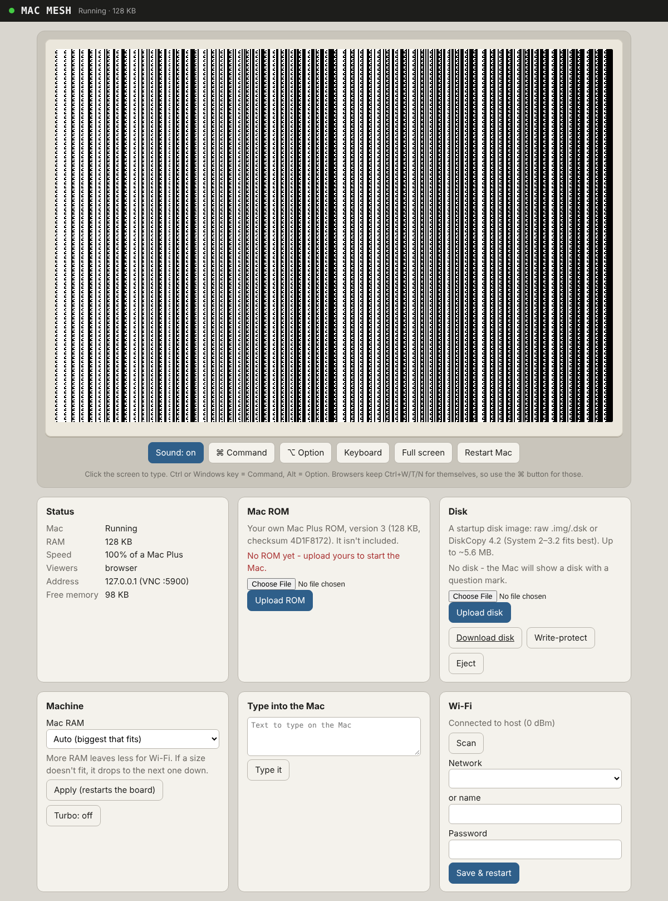

# Heltec-Mac

A Macintosh Plus running on a **Heltec WiFi LoRa 32 V3** (the Meshtastic board). Use it in a
**web browser with sound**, or over **VNC**.

- Motorola 68000 + Mac Plus hardware, built on the umac emulator core (Matt Evans) and the
  Musashi 68000 core (Karl Stenerud)
- **Browser view** on port 80: live screen, sound, mouse, keyboard, paste, full screen. Works on
  a PC, a Raspberry Pi, or a phone.
- **VNC** on port 5900 (no password; Raw + Hextile). No sound over VNC.
- **Your own ROM and disk**: upload a Mac Plus v3 ROM and a startup disk image from the web page.
  They are stored in the board's flash.
- OLED shows the board's address, or a tiny live view of the Mac screen


*(A Mac Plus v3 ROM booted in the browser view with no disk yet: it waits for a startup disk.)*

> Flashing this replaces Meshtastic. To go back, reflash Meshtastic from flasher.meshtastic.org.

## How much Mac fits

The ESP32-S3 on the Heltec has about 512 KB of RAM in total, and Wi-Fi needs a good share of it.
So this Mac has **128 KB** of RAM (like the original Mac 128K), or **256 KB** when there's room
after Wi-Fi, instead of the Plus's usual 1 MB. The ROM is patched to accept that. The Mac Plus
needs a power-of-two memory size, so sizes in between (160, 192, 208 KB) don't work.

128 KB runs **System 2.0 – 3.2** (Finder 4.1 – 5.3) with MacPaint, MacWrite, MacDraw and early
games. System 6 and 7 need more memory and won't boot.

The board starts Wi-Fi first, then gives the Mac what's left. **Auto** uses 256 KB if it fits,
otherwise 128 KB. If the board crashes three starts in a row, it comes up in **safe mode**
without the Mac, so the web page still works and you can pick a smaller size.

## 1. Flash it

**Easiest: the Heltec-Mac Flasher.** Download `flasher/Heltec-Mac-Flasher.html` and open it in
Chrome or Edge on a computer. The firmware is built into the page. Plug the board in, click
**Connect**, pick the board, then **Flash**. It verifies the write, restarts the board, and has
fixes for the common problems (drivers, cables, download mode) right on the page.

**Or with Espressif's web tool:** open `https://espressif.github.io/esptool-js/`, click
**Connect**, set the address to **0x0**, pick `firmware/Heltec-Mac.bin` and click
**Program**. Press the RST button when done.

**Or with esptool:**
```
esptool --chip esp32s3 write-flash 0x0 firmware/Heltec-Mac.bin
```
If the board doesn't show up, hold **PRG**, tap **RST**, release **PRG**, then try again.

Flashing an update later keeps your uploaded ROM and disk.

## 2. Get it on Wi-Fi

On first boot the board makes a hotspot called **Heltec-Mac-Setup** (password **heltecmac**). Join it,
browse to **http://192.168.4.1**, pick your network under *Wi-Fi*, and click **Save & restart**.
The OLED then shows the board's address on your network (it also answers to `heltec-mac.local`).

## 3. Give it a ROM and a disk

On the web page:

1. **Mac ROM**: upload your own ROM. Two are supported:
   - the original **Mac 128K/512K ROM** (64 KB, checksum `28BA61CE`). **Best for this board.**
     It uses less of the Mac's memory than the Plus ROM, so 1984-era software like MacPaint 1.1
     fits in 128 KB. With it the board is a real Mac 128K. It reads 400K MFS disks only.
   - the **Mac Plus ROM version 3** (128 KB, checksum `4D1F8172`). It also reads 800K HFS disks,
     but on a 128 KB Mac it leaves less room: MacPaint 1.1 says there isn't enough memory.

   The page checks the file and says what it is if it's a different ROM. Dumps with extra bytes
   after the ROM are fine; the extra is ignored. No Apple ROM is included.
2. **Disks**: add your disks under **Disks**. They're kept on the board in a **disk library**
   (about 13 400K disks fit), and **Use** starts the Mac from any of them. **Download** saves a
   disk with your changes back to your computer.

   You can add raw `.img`/`.dsk` files and DiskCopy 4.2 `.image` files, or archives with disks
   inside: **.zip, .7z, .sit** (StuffIt 1.5–5, including StuffIt 5's "Arsenic" compression),
   **.hqx** (BinHex), **.bin** (MacBinary) and **.gz**, even one inside another. Your browser
   unpacks the archive and uploads only the disks. If there are several, tick the ones you want
   and they're all added in one go.

   **Programs too:** if an archive holds a loose program instead of a disk (Missile Command, for
   example), the page offers **Add to the disk in use**. It copies the program onto that disk
   (400K MFS disks only) and restarts the Mac; open the disk and it's there.

   For this 128K Mac, the original 400K disks are the ones to use: System 1.x to 3.x and the
   early MacPaint and MacWrite disks, which carry their own System and boot straight into the
   app. HFS 800K disks from System 4 on need 512 KB and stop with an out-of-memory error.
   StuffIt archives that use one of StuffIt's preset compression tables, and StuffIt X (.sitx),
   aren't supported yet; the page says so if it meets one.

The board restarts after uploads and the Mac boots. **Write-protect** stops the Mac from
changing the disk in use.

## 4. Use it

### In a browser (with sound)

Open `http://<board-address>` and click the screen.

- **Sound** is on by default. Browsers only allow audio after a click, so it starts the first
  time you click the screen. The **Sound** button turns it off (remembered in that browser).
- **Mouse**: click and drag on the screen. Any mouse button is the Mac's one button.
- **Keyboard**: Ctrl or the Windows key = **Command**, Alt = **Option**. Browsers keep Ctrl+W/T/N
  for themselves, so use the **⌘ Command** button for those (it holds Command for the next key or
  click).
- **Phones**: tap **Keyboard** to bring up the on-screen keyboard. Paste or use *Type into the Mac*
  for longer text.
- **Full screen** fills the display with the Mac screen.

Only one browser view at a time. A new one takes over from the old one.

### Over VNC

Point any VNC viewer (TigerVNC, RealVNC Viewer, TightVNC, Remmina) at `<board-address>:5900`. No
password. Keys work the same as in the browser, and pasting into the viewer types the text on the
Mac. (macOS Screen Sharing insists on a password, so use one of the others on a Mac.)

| PC key | Mac key |
|---|---|
| Ctrl / Windows key | Command |
| Alt / AltGr | Option |
| Caps Lock | Caps Lock (locks) |
| Backspace / Delete | Backspace |
| Arrows, numeric keypad | Mac Plus arrows and keypad |

## Board buttons and lights

- **PRG** tap: switch the OLED between status and a mini view of the Mac screen
- **PRG** hold 2 s: restart the Mac
- White LED: on while someone is viewing

## Settings

- **Mac RAM**: Auto, 256 or 128 KB (restarts the board)
- **Turbo**: run as fast as the ESP32 can instead of at Mac Plus speed
- **Restart Mac**: like pressing the reset switch

## Troubleshooting

- **Stuck on "JOINING WIFI..." or restarting over and over**: flash the latest firmware. Older
  builds started the Mac before Wi-Fi and could run out of memory.
- **Want to see what the board is doing?** Open the flasher page and use **Watch the board start**.
  It restarts the board and shows its log: Wi-Fi, free memory, and whether the Mac started.
- **The status page says "Not enough free memory"**: choose **128** under Mac RAM and click Apply.

## Limitations

- One disk drive: to switch disks, pick another one in the library (the Mac restarts)
- No SCSI, serial, printer or AppleTalk
- Sound is the Mac Plus's main sound buffer at its normal rate, played in the browser. VNC has no
  sound. The emulator isn't cycle-exact, so some timing-sensitive programs may sound or run a bit
  differently.
- Disk writes are cached and saved to flash after about a second of quiet. Use the Mac's
  **Shut Down** or wait a moment before unplugging.

## Build from source

Arduino IDE with the **esp32** core 3.x, board **Heltec WiFi LoRa 32(V3)**. Open
`Heltec-Mac/Heltec-Mac.ino`. The `partitions.csv` in the sketch folder sets up a 1.9 MB app, the ROM area
and a ~5.6 MB disk area. No extra libraries are needed. The emulator core is in `Heltec-Mac/src/core`.

`host/` has a PC build of the same emulator, VNC and browser-view code for testing:
```
cd host && ./build.sh
./machost --rom plus.rom --disk system.img   # web page http://localhost:8080, VNC localhost:5900
./machost --testrom                          # built-in 68000 test pattern, no ROM needed
python3 tests/viewers_test.py                # (with --testrom --ram 128) checks VNC + browser view
./tests/keys_test                            # keyboard encoding (build: see top of the file)
```

## Licences

Heltec-Mac's own code is yours to use. The firmware also includes code under other licences:
- the replacement floppy driver (`src/core/disc.c`, `sonydrv.h`) comes from **Basilisk II**
  © Christian Bauer, **GNU GPL v2**, so the firmware as a whole is distributed under GPL v2
- **umac** © 2024 Matt Evans, MIT licence (`licenses/umac-LICENSE.txt`), with Heltec-Mac changes:
  RAM size picked at runtime, sound output, absolute mouse, keyboard keypad prefix, no-disk handling,
  support for the original 64 KB Mac 128K ROM (driver swap and drive-queue setup).
- **Musashi** 68000 core © 1998-2002 Karl Stenerud, MIT-style licence (`licenses/Musashi-LICENSE.txt`)
- **SoftFloat** (used by Musashi) © John R. Hauser, see `licenses/SoftFloat-README.txt`
- `web/sit-arsenic.js` (StuffIt "Arsenic" decompression) is a JavaScript port of code from
  **XADMaster** (The Unarchiver) © MacPaw Way Ltd., **GNU LGPL 2.1** (`licenses/XADMaster-LGPL-2.1.txt`)
- Archive formats: StuffIt method 13 and the StuffIt 5 layout are implemented from the format as described by The
  Unarchiver/XADMaster (MacPaw); LZMA and 7z from the public-domain 7-Zip/LZMA SDK documentation
- **esptool-js** (in the flasher page) © Espressif Systems, Apache License 2.0 (`licenses/esptool-js-LICENSE.txt`)

Apple ROMs and system software are **not** included. Use your own.
