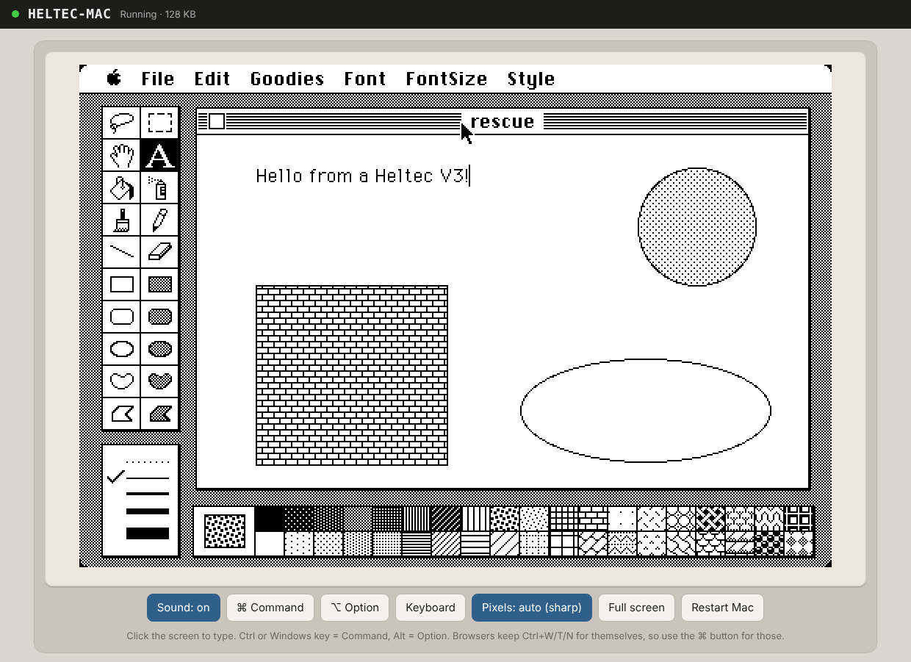
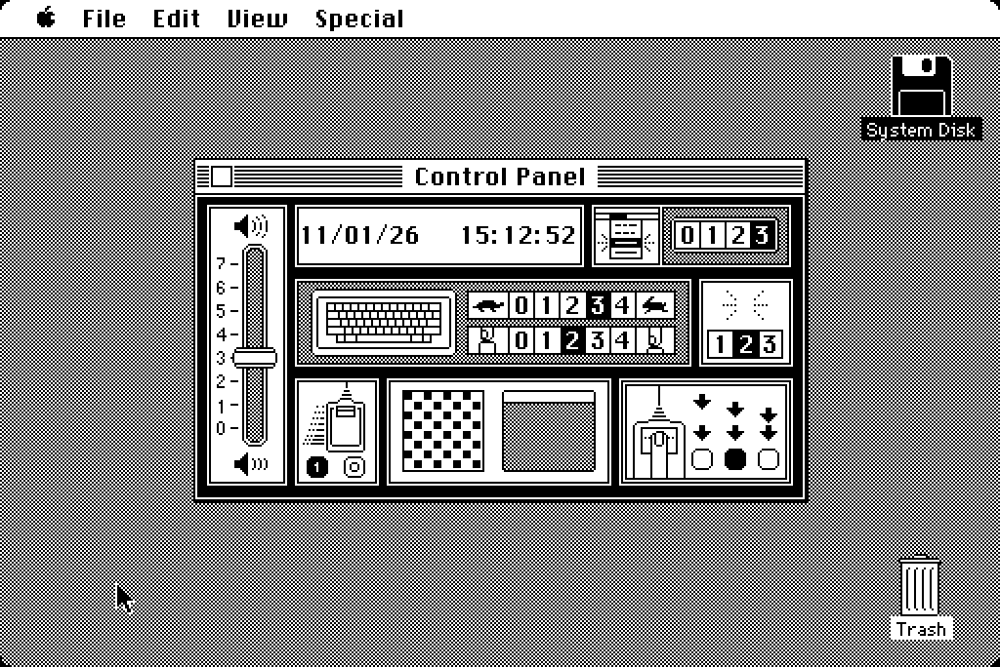
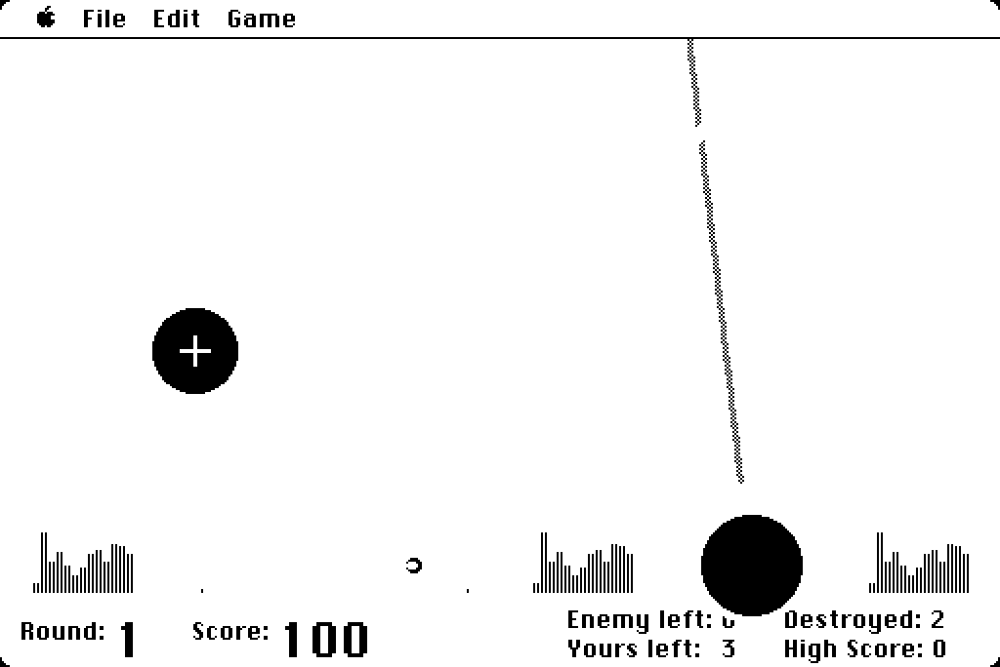
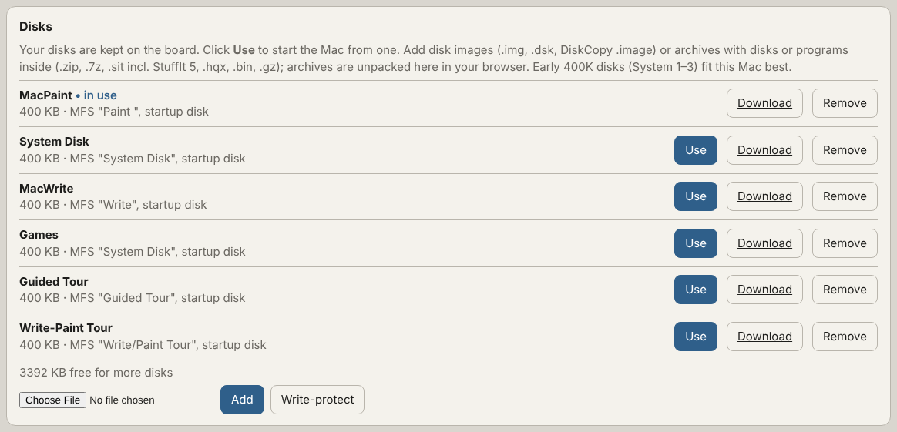
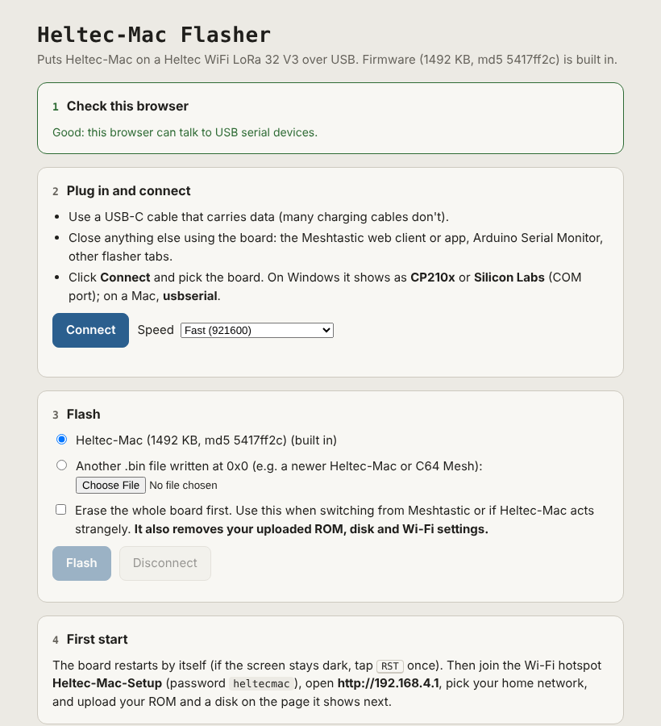

# Heltec-Mac

**A 1984 Macintosh running on a Meshtastic radio board, played in your web browser, with sound.**

Heltec-Mac turns a **Heltec WiFi LoRa 32 V3** (the little ESP32-S3 board many people use for
Meshtastic) into a working Macintosh 128K. The board emulates the Mac's 68000 processor and its
hardware, keeps a library of floppy disks in its own flash, and serves the Mac's screen and
sound to any browser on your network. There's no app to install: open the board's address on a
PC, a Raspberry Pi or a phone, and you're at the Finder.



*MacPaint 1.1 running on the board, viewed in Chrome. Every Mac pixel is drawn as a crisp 2×2 block.*

## Highlights

- **Plays in any modern browser (HTML5).** The screen streams over a WebSocket into a canvas,
  sending only the parts of the screen that changed. Mouse, keyboard, paste, full screen and
  an on-screen keyboard for phones all work. Pixels stay sharp at any display scaling.
- **Real Mac sound in the browser.** The board captures the Mac's own sound hardware (22 kHz,
  8-bit) and streams it to the page, which buffers it against Wi‑Fi hiccups. Beeps, alerts and
  game sounds come through. It's on by default and starts at your first click. When you add a
  ROM or switch disks, the board waits for your browser to reconnect before switching the Mac
  on, so you hear its startup sound.
- **A clock that knows the time.** The Mac's clock chip is emulated and set from your
  computer's time when you open the page. With no browser open, the board keeps time from the
  internet in your time zone. Control Panel settings like volume and mouse speed are saved too.
- **A disk library on the board.** About 13 floppy disks fit in the board's 5.6 MB of disk
  storage. Switch disks with one click, download a disk with your changes, or remove one and
  get its space back.
- **Drop in almost any old Mac file.** Disk images (`.img`, `.dsk`, DiskCopy 4.2 `.image`) and
  archives (`.zip`, `.7z`, `.sit` including StuffIt 5, `.hqx`, `.bin`, `.gz`), even nested
  inside each other. Your browser unpacks them, so the board stays fast. Loose programs, like a
  copy of Missile Command, can be copied straight onto a disk.
- **Your choice of ROM.** Works with the original Mac 128K/512K ROM (recommended) or the
  Mac Plus ROM. ROMs aren't included; bring your own.
- **One-page flasher.** Flash it from Chrome or Edge with a single HTML file. No tools to install.
  It can also back up a whole board to a file and restore or clone it.
- **Extras.** VNC on port 5900, a status display on the board's OLED (or a tiny live view of the
  Mac screen), and a safe mode that keeps the page reachable if something goes wrong.

| The clock follows your computer | Games, with sound |
|---|---|
|  |  |



*The disk library: six original 1984 disks stored on the board, one click to start from any of them.*

## What you need

- A **Heltec WiFi LoRa 32 V3** (ESP32-S3, 8 MB flash) and a USB-C cable that carries data
- **Chrome or Edge** on a computer, for flashing
- Your own **Mac ROM** and **disk images**. Apple's software isn't included.

> Flashing Heltec-Mac replaces Meshtastic on the board. To go back, reflash Meshtastic from
> flasher.meshtastic.org.

## Quick start

### 1. Flash the board

Download [`flasher/Heltec-Mac-Flasher.html`](flasher/Heltec-Mac-Flasher.html) and open it in
Chrome or Edge. The firmware is built into the page. Plug in the board, click **Connect**, pick
it from the list, and click **Flash**. The page checks the write and restarts the board. If
anything goes wrong, the page walks you through the usual fixes (USB driver, cable, download
mode), and **Watch the board start** shows the board's own startup log.



Prefer the command line? `esptool --chip esp32s3 write-flash 0x0 firmware/Heltec-Mac.bin`

Updating later keeps your ROM, disks and Wi‑Fi settings.

**Back up or clone.** After **Connect**, **Back up this board** saves the whole 8 MB flash
(firmware, ROM, every disk and the Wi‑Fi settings) as one verified `.bin` file.
**Write backup to this board** puts it back, or onto a second Heltec V3 to make a clone. The
file holds your Wi‑Fi password and your ROM, so keep it private.

### 2. Put it on your Wi‑Fi

The first time, the board makes its own hotspot: **Heltec-Mac-Setup**, password **heltecmac**.
Join it, open **http://192.168.4.1**, pick your network under **Wi‑Fi**, and click
**Save & restart**. The OLED then shows the board's address on your network. It also answers
to **heltec-mac.local** on most computers.

No Wi‑Fi around? You can also use the Mac straight from the hotspot at http://192.168.4.1.
Your phone or laptop may say the hotspot has no internet; that's expected, so stay connected.
If the board can't find your saved network (say you took it somewhere else), it starts the
hotspot. Every couple of minutes, while nobody is on the hotspot, it checks for your network
again and switches back once it's in range.

### 3. Add a ROM

Under **Mac ROM**, upload your ROM file. The page checks it and tells you what it is.

| ROM | Size | Checksum | Notes |
|---|---|---|---|
| **Mac 128K / 512K** | 64 KB | `28BA61CE` | **Recommended.** Makes the board a real Mac 128K, with room for MacPaint and MacWrite. Reads 400K disks. |
| Mac Plus (version 3) | 128 KB | `4D1F8172` | Also reads 800K disks, but uses more of the Mac's small memory, so some 1984 apps won't fit. |

### 4. Add disks and start the Mac

Under **Disks**, choose a disk image or an archive and click **Add**. If a file holds several
disks, tick the ones you want and they're all added in one go. Click **Use** next to a disk to
start the Mac from it.

## Using it

Open `http://<board address>` (or `http://heltec-mac.local`) and click the Mac screen.

- **Mouse:** click and drag on the screen. Any mouse button is the Mac's one button.
- **Keyboard:** **Ctrl** or the **Windows key** is the Mac's **Command** key, and **Alt** is
  **Option**. Browsers keep a few shortcuts for themselves (Ctrl+W, T, N), so the **⌘ Command**
  button holds Command for your next key or click.
- **Paste** text from your computer straight into the Mac, or use **Type into the Mac** for
  longer text.
- **Phones and tablets:** tap **Keyboard** for the on-screen keyboard.
- **Sound** is on by default and starts at your first click. The **Sound** button turns it off,
  and your choice is remembered.
- **Pixels:** **Auto** keeps the screen razor sharp when there's room, **Fill** uses all the
  space. **Full screen** gives you just the Mac.
- **Restart Mac** works like the Mac's reset switch.

One browser at a time can view the Mac. Opening it somewhere else takes over.

### Disks and programs

| You add | What happens |
|---|---|
| `.img`, `.dsk` (raw disk image) | Stored as is |
| `.image` (DiskCopy 4.2) | Header removed, stored as a disk |
| `.zip`, `.7z`, `.gz` | Unpacked in your browser; every disk inside is offered |
| `.sit` (StuffIt 1.5 to 5, including "Arsenic" compression) | Unpacked in your browser; checksums verified |
| `.hqx` (BinHex), `.bin` (MacBinary) | Decoded in your browser |
| A loose program inside any of these | **Add to the disk in use** copies it onto that disk |
| An 800K HFS disk with no System on it (a game or app disk) | Its programs are pulled out and offered for **Add to the disk in use** |

- **Download** saves a disk, with everything you've changed, back to your computer.
- **Remove** deletes a disk and gives its space back. The disks after it slide down in flash,
  which can take a few seconds.
- **Write-protect** stops the Mac from changing the disk in use.

**What runs well:** the original 400K disks from 1984 to 1986. That means System 1.x to 3.x,
MacPaint, MacWrite, the Guided Tour and early games. Each original app disk carries its own
System, so it starts straight into the app. Disks for System 4 and later (800K HFS) need a Mac
with 512 KB or more, which doesn't fit on this board. Many small 800K game disks are just one
program, though, and those usually run fine once copied onto a 400K System disk.

### Battery

With a LiPo plugged into the board's battery connector, the OLED's title bar shows its voltage
and charge (for example `3.9V 72%`), and the web page shows it in the header and Status panel.
`USB` means it's on USB power with the battery full or charging; `NO BAT` means nothing is
connected. The reading is a rough guide: it comes from the board's voltage divider, like
Meshtastic's.

### Sleep

**Sleep board** (next to Restart Mac) saves the disk, switches off the screen, Wi-Fi and LED,
and puts the Heltec into deep sleep. Press **PRG** (or RST) on the board to wake it. The page
waits and reconnects by itself, and the Mac starts once you're watching, so you hear the chime.

### Clock

Each time the page opens, your browser sends your computer's local time and the Mac's clock is
set to match. The menu bar, Alarm Clock, Control Panel and file dates all use it. With no
browser open, the board sets the time from the internet using the time zone your browser last
reported, so the clock is right even after a power cut.

### Over VNC

Any VNC viewer (TigerVNC, RealVNC Viewer, TightVNC, Remmina) can connect to
`<board address>:5900` with no password. The keys are the same as in the browser. VNC has no
sound; use the browser for that.

### The board itself

- **OLED:** the board's address and the Mac's status. Tap **PRG** to switch to a tiny live view
  of the Mac screen.
- **Hold PRG for 2 seconds** to restart the Mac.
- **White LED:** a short, dim blink every few seconds while someone is viewing.
- **Safe mode:** if the board crashes three starts in a row, it comes up without the Mac so the
  page still works and shows what happened.

## How it works

The ESP32-S3 has two processor cores and 512 KB of RAM:

- **Core 1** runs the Mac: the Musashi 68000 emulator plus the Mac's hardware (video, sound,
  keyboard, mouse, clock chip, floppy drive), based on the umac emulator. It runs at the speed
  of a real 8 MHz Mac.
- **Core 0** runs Wi‑Fi, the web page, the WebSocket stream and VNC. The screen is sent as
  16×16 blocks, and only the blocks that changed. Sound goes out in small bundles, and silence
  costs nothing.
- **Memory:** the Mac gets 128 KB of RAM, just like a 1984 Mac 128K. Wi‑Fi and the web page
  need most of the rest. The ROM stays in flash and is read directly from there.
- **Flash (8 MB):** the firmware, your ROM, and a 5.6 MB disk library. Disk writes are cached
  and saved to flash a second after the Mac goes quiet.
- **Your browser** does the heavy lifting for files: unpacking ZIP, 7-Zip, StuffIt and BinHex,
  and even writing programs onto Mac disks, before sending the finished disk to the board.

## Limitations

- The Mac has 128 KB of RAM, because that's what the board can spare. System 1 to 3 software
  runs; System 4 and later doesn't. A board with PSRAM (extra memory) would allow a bigger Mac.
- One floppy drive. To switch disks, pick another one in the library, and the Mac restarts.
- No serial ports, printer, AppleTalk or SCSI.
- The emulation isn't cycle-exact, so a few timing-sensitive programs may run or sound slightly
  differently.
- Browser sound lags about 0.1 to 0.3 seconds behind the picture, to ride out Wi‑Fi hiccups.
- Wait a moment after the Mac writes to its disk before unplugging, or use **Shut Down** on the
  Mac.

## Troubleshooting

- **The board isn't in the flasher's list:** try another cable (many only charge) or another
  USB port. Windows needs the Silicon Labs **CP210x** driver.
- **Flashing stops at "Connecting":** hold **PRG**, tap **RST**, release **PRG**, and connect
  again. Choose **Slow** speed in the flasher.
- **Stuck on "JOINING WIFI..." or restarting:** flash the latest version. To see why, use
  **Watch the board start** in the flasher.
- **"There is not enough room in memory":** use the Mac 128K ROM instead of the Plus ROM.
- **No sound:** click the Mac screen once (browsers need a click before playing sound) and check
  that the **Sound** button says **on**.

## Building from source

Arduino IDE (or arduino-cli) with the **esp32** core 3.x, board **Heltec WiFi LoRa 32(V3)**. Open
[`Heltec-Mac/Heltec-Mac.ino`](Heltec-Mac/Heltec-Mac.ino). The `partitions.csv` in the sketch
folder sets up the app, the ROM area and the disk library. No extra libraries are needed.

| Folder | What's in it |
|---|---|
| `Heltec-Mac/` | The firmware: emulator glue, web page, WebSocket view, VNC, disk library |
| `Heltec-Mac/src/core/` | The emulator core (umac + Musashi) with Heltec-Mac's changes |
| `web/` | The browser-side unpackers (`macfiles.js`, `sit-arsenic.js`) and a WebAssembly build |
| `flasher/` | The one-page flasher and the script that builds it from the firmware |
| `host/` | A PC build of the same emulator and web page, plus tests |
| `firmware/` | The ready-to-flash firmware image |

The PC build runs the same code on a desktop for testing:

```
cd host && ./build.sh
./machost --rom mac128k.rom --disk system.img   # web page at http://localhost:8080, VNC on 5900
./machost --testrom                             # built-in test pattern, no ROM needed
```

After changing `web/*.js`, run `python3 tools/embed_js.py` to rebuild the copy the board serves.
After changing the firmware, `flasher/make_flasher.py` rebuilds the flasher page.

## Credits and licences

Heltec-Mac stands on the shoulders of some wonderful projects:

- **umac** by Matt Evans (MIT, `licenses/umac-LICENSE.txt`), the compact Mac emulator at the
  heart of this. Heltec-Mac adds runtime memory sizing, sound output, an absolute mouse, the
  clock chip with parameter RAM, Mac 128K ROM support, a disk library and more.
- **Musashi** 68000 emulator by Karl Stenerud (MIT-style, `licenses/Musashi-LICENSE.txt`), with
  **SoftFloat** by John R. Hauser (`licenses/SoftFloat-README.txt`).
- The replacement floppy driver (`src/core/disc.c`, `sonydrv.h`) comes from **Basilisk II** by
  Christian Bauer, under the **GNU GPL v2**, so the firmware as a whole is distributed under the
  GPL v2.
- `web/sit-arsenic.js` is a JavaScript port of StuffIt "Arsenic" decompression from
  **XADMaster** (The Unarchiver) by MacPaw, under the **GNU LGPL 2.1**
  (`licenses/XADMaster-LGPL-2.1.txt`). StuffIt method 13 and the StuffIt 5 layout follow the
  format as described there; 7-Zip/LZMA follow the public-domain LZMA SDK documentation.
- **esptool-js** by Espressif (Apache 2.0, `licenses/esptool-js-LICENSE.txt`) powers the flasher.

Heltec-Mac's own code is yours to use. Apple ROMs and system software are **not** included and
aren't covered by any of this; use your own copies.
